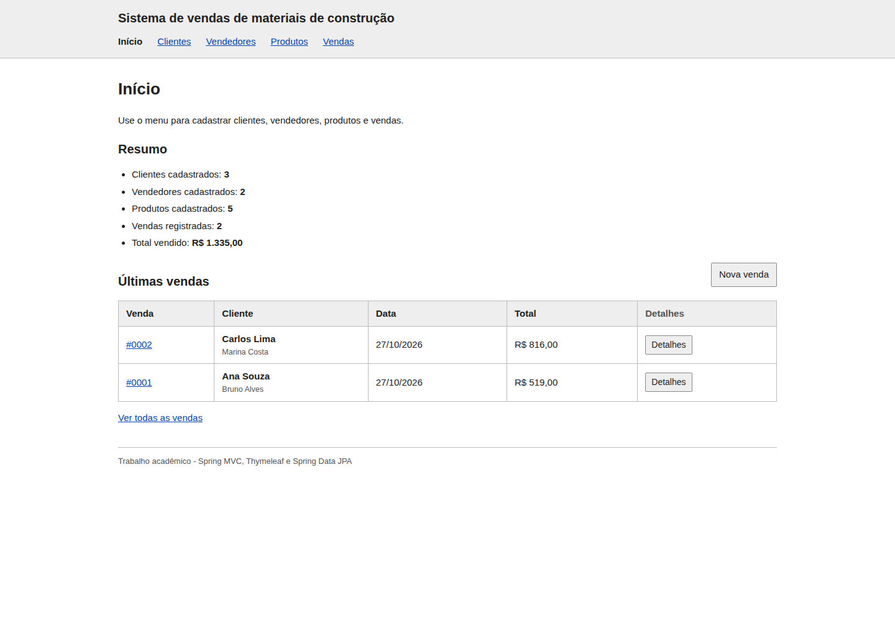
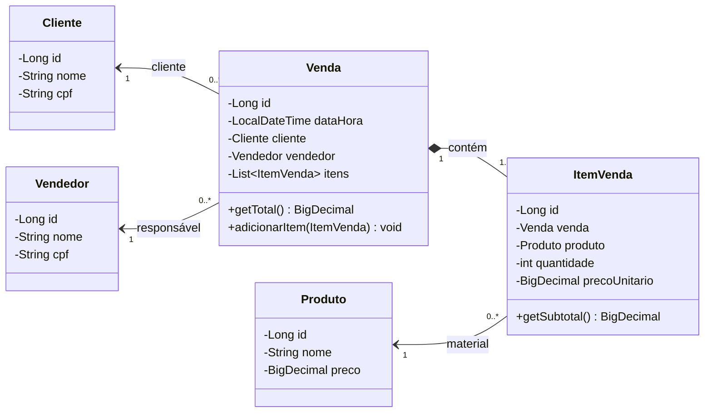
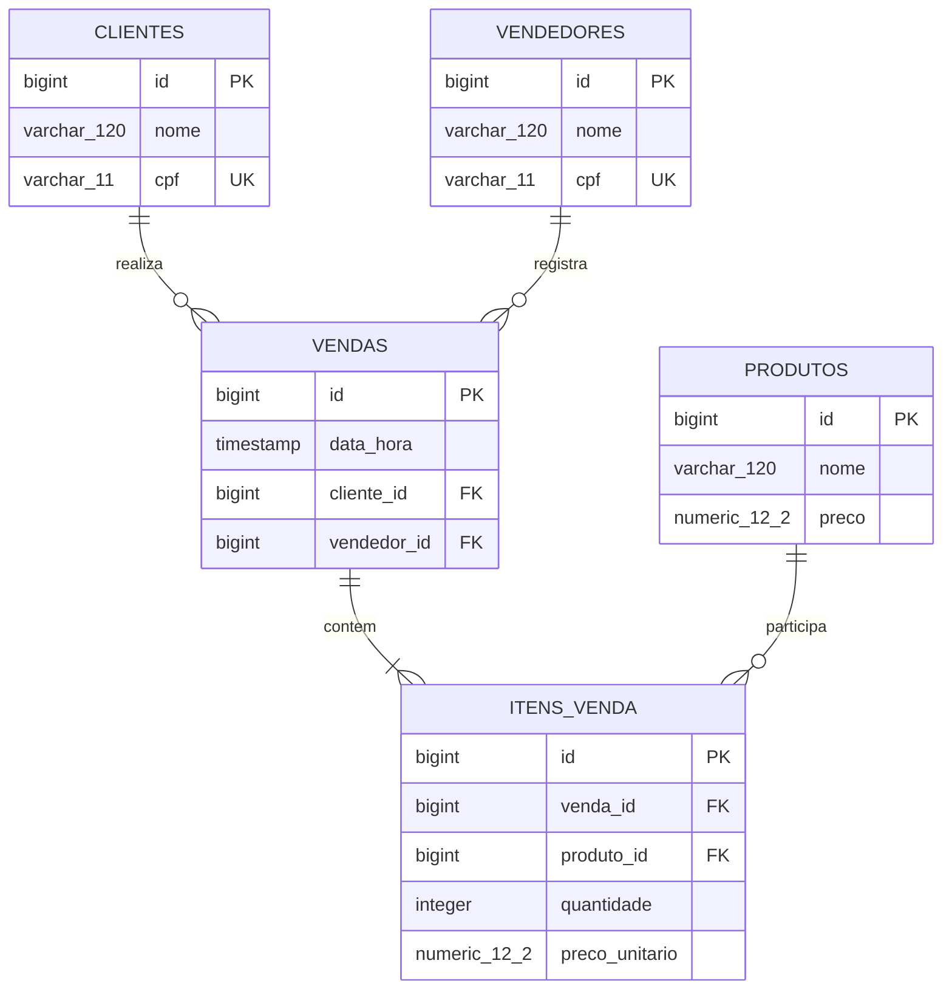
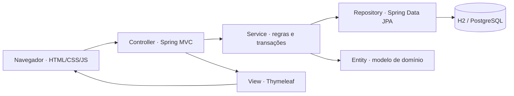

# Sistema de vendas de materiais de construção

Sistema web para uma loja de materiais de construção. Permite cadastrar clientes, vendedores e produtos, montar vendas com vários materiais e consultar o histórico. Migração do [projeto Java Swing](https://github.com/ewillcode/poo-jdbc-swing) para **Spring MVC, Thymeleaf e Spring Data JPA**, com Java 21.

**Repositório para entrega:** https://github.com/andrey-rebelatto/construction-material-sales

**[Abrir os protótipos navegáveis](https://andrey-rebelatto.github.io/construction-material-sales/prototipos/)** · [Arquivos dos protótipos](docs/prototipos/) · [Roteiro de apresentação](docs/roteiro-apresentacao.md)



## Critérios da atividade

| Exigência | Implementação |
| --- | --- |
| Tema definido | Gestão de vendas de materiais de construção, preservando o domínio do sistema desktop. |
| Banco de dados relacional | H2 persistente em arquivo; perfil opcional para PostgreSQL. |
| Quatro ou mais tabelas | Cinco tabelas: `clientes`, `vendedores`, `produtos`, `vendas` e `itens_venda`. |
| CRUD com telas | Cadastro, listagem, edição e exclusão de clientes, vendedores, produtos e vendas. Itens têm inclusão, edição, listagem e remoção dentro da venda. |
| Spring Framework | Spring Boot 3.5.16, Spring MVC, Thymeleaf e Spring Data JPA. |
| Model | Pacotes `model/entity`, `model/repository` e `model/service`. |
| Control | Pacote `controller`, com formulários em `controller/form`. Controllers acessam os services. |
| View | Templates Thymeleaf em `templates`, CSS e JavaScript em `static`. |
| Protótipos de tela | [Versão navegável](https://andrey-rebelatto.github.io/construction-material-sales/prototipos/) e capturas em `docs/prototipos/imagens`. |
| Diagrama de classes | Incluído abaixo e em [Mermaid](docs/diagramas/classes.mmd). |
| Diagrama MER | Incluído abaixo e em [Mermaid](docs/diagramas/mer.mmd), compatível com a migração SQL. |
| README e GitHub | Este arquivo documenta a execução, os diagramas e os links de entrega. |

## Executar

Instale o **JDK 21**. O Maven Wrapper baixa o Maven na primeira execução, que precisa de internet.

```bash
git clone https://github.com/andrey-rebelatto/construction-material-sales.git
cd construction-material-sales
./mvnw spring-boot:run
```

No Windows, use `mvnw.cmd spring-boot:run`. Se já tiver Maven instalado, `mvn spring-boot:run` também funciona.

Abra **http://localhost:8080**. No IntelliJ, abra o `pom.xml`, selecione o JDK 21 e execute `MaterialConstrucaoApplication`.

Na primeira execução, o Flyway cria as tabelas e a aplicação inclui dados fictícios de demonstração: três clientes, dois vendedores, cinco produtos e duas vendas. O banco fica em `data/construa.mv.db`, fora do Git, e os dados continuam disponíveis ao reiniciar. A carga de exemplo só roda quando os cadastros estão vazios. Para iniciar sem ela:

```bash
./mvnw spring-boot:run -Dspring-boot.run.arguments="--app.dados-exemplo=false"
```

A aplicação é acadêmica, sem autenticação de usuários. Os formulários têm proteção CSRF, validação no servidor e saída HTML escapada. A versão Swing continua no repositório original; o banco SQLite antigo não é importado automaticamente.

### PostgreSQL opcional

O padrão H2 atende ao requisito de banco relacional sem instalar um servidor. Para testar com PostgreSQL 17, use Docker Compose e escolha uma senha no seu terminal:

```bash
read -s DB_PASSWORD
export DB_PASSWORD
docker compose up -d
./mvnw spring-boot:run -Dspring-boot.run.profiles=postgres
```

O comando `read -s` é para Bash/Zsh. Configure `DB_PASSWORD` pelo mecanismo do seu sistema se usar outro shell. `DB_URL` e `DB_USER` também podem ser definidos para usar outro servidor. O perfil PostgreSQL usa a mesma migração Flyway e os mesmos services. Encerre o banco com `docker compose down`. O volume preserva os dados.

## Funcionalidades e regras

- **Início:** resumo dos cadastros, total vendido e últimas vendas.
- **Clientes e vendedores:** nome e CPF, busca por nome, cadastro, edição e exclusão. CPF com validação dos dígitos e unicidade por tabela, armazenado sem pontuação.
- **Produtos:** nome, preço positivo com até duas casas decimais, busca e CRUD completo.
- **Vendas:** cliente, vendedor e até 100 linhas de materiais. Quantidades inteiras de 1 a 1.000.000 por produto; produtos repetidos são agrupados. Total recalculado no servidor com `BigDecimal`.
- **Histórico de preço:** cada item guarda o preço unitário da venda. Alterar o catálogo não muda o histórico. Ao editar uma venda, produtos mantidos conservam o preço original; produtos novos usam o preço atual.
- **Integridade:** venda e itens são gravados na mesma transação. Cadastros vinculados não podem ser excluídos. A exclusão de venda remove seus itens.
- **Interface:** menu horizontal, tabelas e formulários com CSS básico, mensagens de validação e confirmação antes de excluir.

## Primeira etapa: tema e protótipos

**Tema:** sistema de gestão de vendas de uma loja de materiais de construção.

**Objetivo:** substituir as janelas Swing por telas web, mantendo as entidades e regras centrais do projeto original.

Os protótipos são telas HTML simples, com dados fictícios. Os links permitem navegar entre listagens, cadastros, edição e detalhes. O carrinho demonstra inclusão e remoção de materiais e cálculo do total. **Os protótipos estáticos não gravam no banco**; o CRUD real funciona ao executar o Spring Boot.

| Tela | Protótipo HTML | Captura |
| --- | --- | --- |
| Início | [Início](docs/prototipos/index.html) | [Imagem](docs/prototipos/imagens/01-painel.png) |
| Clientes | [Listagem](docs/prototipos/clientes.html), [cadastro](docs/prototipos/cliente-novo.html), [edição](docs/prototipos/cliente-editar.html) | [Imagem](docs/prototipos/imagens/02-clientes.png) |
| Vendedores | [Listagem](docs/prototipos/vendedores.html), [cadastro](docs/prototipos/vendedor-novo.html), [edição](docs/prototipos/vendedor-editar.html) | [Imagem](docs/prototipos/imagens/03-vendedores.png) |
| Produtos | [Listagem](docs/prototipos/produtos.html), [cadastro](docs/prototipos/produto-novo.html), [edição](docs/prototipos/produto-editar.html) | [Imagem](docs/prototipos/imagens/04-produtos.png) |
| Vendas | [Listagem](docs/prototipos/vendas.html), [cadastro](docs/prototipos/venda-nova.html), [edição](docs/prototipos/venda-editar.html), [detalhes](docs/prototipos/venda-detalhe.html) | [Imagem](docs/prototipos/imagens/05-vendas.png) |
| Carrinho da venda | [Nova venda](docs/prototipos/venda-nova.html) | [Imagem](docs/prototipos/imagens/06-nova-venda.png) |
| Detalhes da venda | [Detalhes](docs/prototipos/venda-detalhe.html) | [Imagem](docs/prototipos/imagens/07-detalhe-venda.png) |
| Celular | Mesmas páginas, com layout responsivo | [Imagem](docs/prototipos/imagens/08-celular.png) |

Para abrir sem GitHub Pages, baixe o repositório e abra `docs/prototipos/index.html` no navegador, ou sirva `docs/` com `python3 -m http.server 8000 --directory docs`.

### Diagrama de classes das entidades



Os IDs são gerados pelo banco. `Venda.total` e `ItemVenda.subtotal` são calculados pelos métodos e não ocupam colunas adicionais. A composição entre venda e itens usa `cascade = ALL` e `orphanRemoval = true`. As outras relações não propagam exclusões.

### Diagrama MER



Um cliente e um vendedor podem ter várias vendas. Cada venda tem um cliente, um vendedor e ao menos um item. Cada item referencia um produto. A cardinalidade mínima de um item é garantida pelo service; as chaves estrangeiras garantem as referências no banco.

Há unicidade de CPF em cada tabela de pessoas e uma restrição composta `UNIQUE (venda_id, produto_id)` em `itens_venda`. Preços usam `NUMERIC(12,2)`. As restrições `CHECK` impedem preços e quantidades inválidos. O SQL está em [V1__criar_tabelas.sql](src/main/resources/db/migration/V1__criar_tabelas.sql). O Flyway também mantém uma tabela técnica de histórico de migrações, além das cinco tabelas de domínio.

## Arquitetura MVC



```text
src/main/java/br/edu/materialconstrucao/
├── MaterialConstrucaoApplication.java
├── config/               segurança CSRF e dados de exemplo
├── model/
│   ├── entity/           Cliente, Vendedor, Produto, Venda, ItemVenda
│   ├── repository/       interfaces Spring Data JPA
│   └── service/          regras de negócio e transações
├── controller/           rotas MVC e tratamento dos formulários
│   └── form/             DTOs com Bean Validation
└── view/                 formatação de moeda e CPF
src/main/resources/
├── db/migration/         criação versionada das tabelas
├── templates/            telas Thymeleaf e fragmentos
└── static/               CSS, JavaScript e favicon
```

Exemplo ao salvar uma venda: o `VendaController` valida o formulário e chama `VendaService`. O service consulta os demais services, agrupa os produtos e grava venda e itens em uma transação pelo `VendaRepository`. O controller redireciona para a página de detalhes, renderizada pelo Thymeleaf. A regra de dependência entre controllers e services tem um teste com ArchUnit.

## Verificação

```bash
./mvnw verify
```

A suíte tem 32 testes. Os testes de CRUD e regras de negócio foram executados em H2 e PostgreSQL 17; os testes HTTP com Tomcat verificam sessões novas e páginas de erro. O banco de testes é separado do banco local. Cobrem renderização das telas, CRUDs via HTTP, validação de CPF e preços, CSRF, escape HTML, agrupamento de produtos, cálculo de totais, edição com preço histórico, rollback, exclusão em cascata e bloqueio de cadastros em uso. O GitHub Actions executa a mesma verificação a cada push e pull request.

## Referências

- [Documentação do Spring Boot 3.5](https://docs.spring.io/spring-boot/3.5/index.html)
- [Spring MVC](https://docs.spring.io/spring-framework/reference/web/webmvc.html)
- [Spring Data JPA](https://docs.spring.io/spring-data/jpa/reference/)
- [Thymeleaf com Spring](https://www.thymeleaf.org/doc/tutorials/3.1/thymeleafspring.html)
