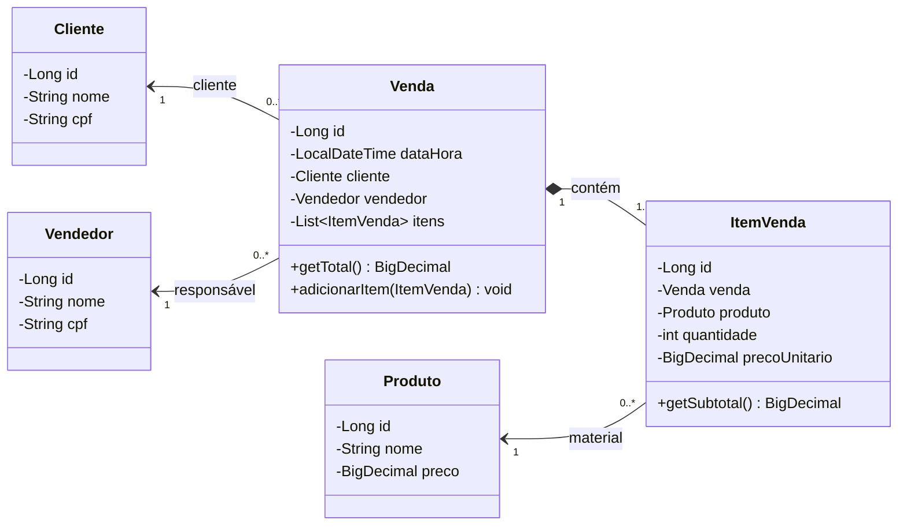
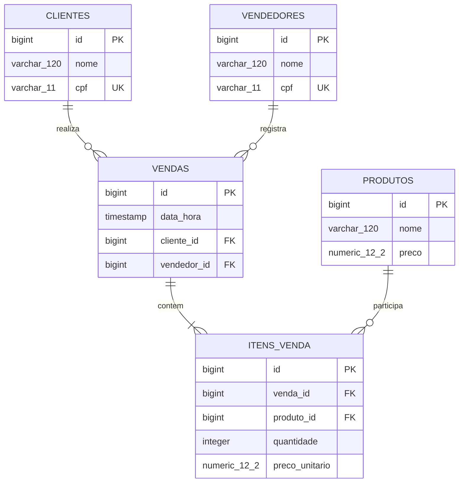

# Vendas de materiais de construção

Sistema acadêmico com cadastro, edição, exclusão e consulta de clientes, vendedores, produtos e vendas.

Java 21, Spring MVC, Thymeleaf e Spring Data JPA. Arquitetura MVC, com controllers acessando os services.

## Executar

```bash
./mvnw spring-boot:run
```

Acesse http://localhost:8080. O banco H2 fica em `data/` e recebe dados de exemplo na primeira execução.

Para rodar os testes: `./mvnw verify`.

## Protótipos

[Abrir protótipos de tela](https://andrey-rebelatto.github.io/construction-material-sales/prototipos/). São demonstrações estáticas; o CRUD funciona na aplicação local.

## Diagramas

<details>
<summary>Diagrama de classes</summary>



</details>

<details>
<summary>Diagrama MER</summary>



</details>
